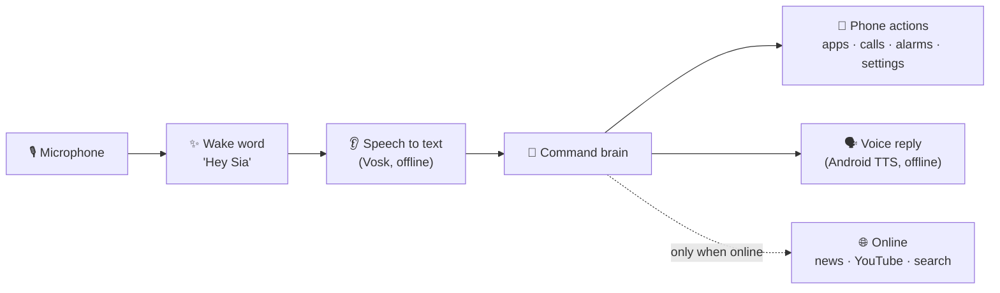

<p align="center">
  
</p>

<p align="center">
  
  
  
  
  
  
  
</p>

<p align="center">
  <b>Say "Hey Sia" and she does it.</b> Open apps, make calls, play music, set alarms, toggle Wi-Fi and more.<br>
  Everything runs on your phone. No cloud, no accounts, no paid APIs.
</p>

---

## Why Sia?

| | |
|---|---|
| 🔌 **Offline first** | Wake word, speech recognition, voice and commands all run on the device. |
| 🔒 **Private by design** | Sia never touches your photos, documents, notes or email. Audio never leaves the phone. |
| 💸 **100% free** | Built only on free, open-source tools. No subscriptions, no API keys. |
| 🌐 **Online when you say so** | Need news or YouTube? Say *"turn on data"* and she goes online. Until then, she stays offline. |

## What she can do

Say **"Hey Sia"**. She answers (*"Yes?"*), then say your command.

| Category | Try saying | Works offline |
|---|---|:---:|
| 📱 Apps | *"Open YouTube"*, *"Open camera"*, *"Launch Play Store"* | ✅ |
| 📞 Calls | *"Call Mom"*, *"Dial zero one seven one two..."* | ✅ |
| ⏰ Alarms | *"Set an alarm for six thirty"*, *"Wake me up at 7 in the morning"* | ✅ |
| ⏱️ Timers | *"Timer for ten minutes"*, *"Set a timer for half an hour"* | ✅ |
| 🔦 Flashlight | *"Flashlight on"*, *"Turn off the torch"* | ✅ |
| 🔊 Volume | *"Volume up"*, *"Volume max"*, *"Set volume to five"*, *"Mute"* | ✅ |
| 📶 Connections | *"Turn on Wi-Fi"*, *"Bluetooth off"*, *"Turn on hotspot"*, *"Airplane mode on"* | ✅ |
| 🌐 Go online | *"Turn on data"*, *"Go online"*, *"Am I online?"* | ✅ |
| 🎵 Music | *"Play Believer"* (your songs offline, YouTube/Vanced online), *"Play Shape of You on YouTube"* | ✅ / 🌐 |
| ⏯️ Playback | *"Pause"*, *"Resume"*, *"Next song"*, *"Previous song"* | ✅ |
| 💬 Messages | *"Send a WhatsApp message to Rafi saying I'm on my way"*, *"Message Tanvir on Messenger saying call me"* | 🌐 |
| 🔔 Notifications | *"Read my notifications"*, *"Do I have any messages?"* | ✅ |
| ☀️ Morning briefing | *"Good morning"*, *"Plan my day"* (time, date, next alarm, battery, headlines) | ✅ / 🌐 |
| 📰 News | *"Tell me today's latest news"*, *"Cricket news"* | 🌐 |
| 🔎 Search | *"Search for best biryani in Dhaka"* | 🌐 |
| 🕐 Info | *"What time is it?"*, *"What's the date?"*, *"Battery"* | ✅ |
| ❓ Help | *"What can you do?"* | ✅ |

If Sia isn't sure, she asks: *"Who should I call?"*, *"Did you mean Rafi?"*, *"For what time?"*.
Before sending any message, she reads it back and asks *"Should I send it?"*.

**No wake word needed:** tap **Talk now** in the app or the notification, add the **Sia** tile to Quick Settings,
or long-press Sia's icon and choose **Talk to Sia**.

## Privacy promise

Sia asks only for what a feature truly needs. Every permission is explained in the app's setup checklist.

| Permission | Why | Required? |
|---|---|:---:|
| 🎙️ Microphone | Hear "Hey Sia" and your commands. Processed on the phone only. | ✅ |
| 🔔 Notifications | Show that Sia is listening, and tell you when a song isn't found | Optional |
| 🪟 Display over other apps | Open apps, the dialer and the clock from the background | Optional |
| ♿ Accessibility | Tap Quick Settings switches and the Send button, only when you ask | Optional |
| 📨 Notification access | Read notifications aloud when you ask | Optional |
| 👥 Contacts | Call and message people by name (names and numbers only, never stored) | Optional |
| 📞 Phone | Start calls straight away (otherwise the dialer opens) | Optional |
| 🎵 Music files | Play your own songs offline. **Audio only**: no photos, videos or documents. | Optional |

- ❌ **Never:** photos, videos, documents, notes, email, accounts, location, call history, SMS
- 🙈 **Private apps list:** notifications from email, photos, notes, banking, payment and password apps are never read aloud. You can edit the list.
- 🔢 **One-time codes** (OTPs, verification codes) are never read aloud, from any app.
- 💾 **Nothing is saved:** no recordings, no transcripts on disk, no history. The "Recent" list on screen lives in memory only.
- 🎧 **Speech recognition:** "Hey Sia" is always detected on the phone. Commands use your phone's own speech
  recognition (much more accurate). With the **offline English pack** installed, that also runs on the phone.
  Prefer 100% offline? Choose *Sia's built-in offline model* in **Listening settings**.
- 📴 **No internet needed** for listening, speaking or commands. The internet is used only for YouTube, news and search, and only when you're already online.

## Install on your phone

### Option A: build it yourself
1. Install [Android Studio](https://developer.android.com/studio) (free).
2. Clone the repo
   ```bash
   git clone https://github.com/nuhanhabib/Hey-Sia.git
   ```
3. Open the folder in Android Studio and wait for Gradle sync.
   The first build downloads the free offline speech model (~40 MB) and packs it into the app.
4. On your phone: **Settings → About phone → Software information →** tap **Build number** 7 times,
   then **Developer options → USB debugging** on. Plug in your phone.
5. Press **▶ Run**. Or use **Build → Build App Bundle(s) / APK(s) → Build APK(s)** and copy the APK to your phone.

### Option B: install an APK
Download the APK, open it on your phone, and allow **Install unknown apps** when Android asks.

## First-time setup (2 minutes)

1. Open **Sia** and work through the **Setup** checklist. Each item says why it's needed.
2. **Accessibility** and **Notification access** may show *"Restricted setting"* because Sia isn't from the Play Store.
   Fix: **Settings → Apps → Sia → ⋮ (top right) → Allow restricted settings**, then turn them on again.
3. Allow **Keep running in background** so Samsung's battery saver doesn't close Sia.
4. **For the best accuracy offline:** open the **Google app → profile picture → Settings → Voice →
   Offline speech recognition** and download **English**. (Shortcut in Sia's **Listening settings**.)
5. Tap **Turn on Sia**. A small notification shows she's listening.
6. Say **"Hey Sia"**. When she answers, try *"What can you do?"*

## Good to know

- **Wait for her answer** after "Hey Sia" (*"Yes?"*) before saying your command.
- **She mishears you?** Open **Listening settings** and try the English accent closest to yours.
- **After restarting your phone, open Sia once.** Android doesn't let apps switch the microphone on by themselves at startup.
- **Quick Settings tiles:** Wi-Fi, Bluetooth, mobile data and hotspot are switched through your Quick Settings panel, so those tiles must be in the panel.
- **Messenger** has no official way for other apps to start a chat, so Sia does it on screen. If Messenger changes its layout, this may need an update. WhatsApp is more reliable.
- **Accuracy:** Sia hears up to 5 guesses of what you said and picks the one that matches an app, contact or command.
  The built-in offline model is small (~40 MB) and less accurate than the phone's recognition.

## How it works



## Tech stack

| Part | Tool | Why |
|---|---|---|
| Language & UI | Kotlin + Jetpack Compose | Native Android, full access to phone features |
| Speech to text | Phone's speech recognition (offline pack), with [Vosk](https://alphacephei.com/vosk/) as fully offline fallback | Accurate with accents; free; works offline |
| Wake word | Vosk with a restricted grammar | Strict "Hey Sia" detection with no extra model or account |
| Voice | Android TextToSpeech | Built into the phone, works offline |
| Phone control | Android intents + Accessibility Service | Opens apps, dials, toggles settings like a human would |
| News | Free RSS feeds (Google News, BBC) | No API key needed |

## Project structure

```
app/src/main/java/com/heysia/app/
├── MainActivity.kt            # App entry point and navigation
├── service/                   # Always-on background service ("Hey Sia" loop)
├── listen/                    # Offline speech recognition (Vosk)
├── voice/                     # Text to speech + everything Sia says
├── brain/                     # Understanding commands (parser, numbers, fuzzy matching)
├── actions/                   # Apps, calls, alarms, music, news, device controls
├── a11y/                      # Accessibility: Quick Settings switches, WhatsApp, Messenger
├── notify/                    # Reading notifications + private apps list
├── tile/                      # Quick Settings "Sia" tile
└── ui/                        # Screens and theme
```

Run the unit tests with:
```bash
./gradlew testDebugUnitTest
```

## Roadmap

- [x] Step 1: Project setup
- [x] Step 2: Sia speaks (offline text to speech)
- [x] Step 3: Sia listens (offline speech to text)
- [x] Step 4: "Hey Sia" wake word, always ready in the background
- [x] Step 5: Command brain: apps, calls, alarms, timers, flashlight, volume
- [x] Step 6: Music: your songs offline, YouTube / Vanced online
- [x] Step 7: Wi-Fi, Bluetooth, hotspot, mobile data, WhatsApp & Messenger messages
- [x] Step 8: Read notifications aloud (with private apps list)
- [x] Step 9: Online mode, news and morning briefing
- [x] Step 10: Polish: icon, theme, Quick Settings tile, shortcut
- [ ] More languages
- [ ] Optional on-device AI for free-form questions

## License

Released under the [MIT License](LICENSE). © 2026 <a href="https://github.com/nuhanhabib">Nuhan Habib.</a>
