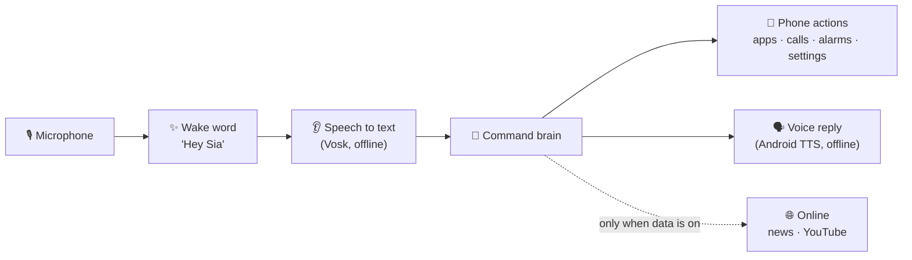

<p align="center">
  
</p>

<p align="center">
  
  
  
  
  
  
  
</p>

<p align="center">
  <b>Say "Hey Sia" and she does it.</b> Open apps, make calls, play music, set alarms, toggle Wi-Fi and more.<br>
  Everything runs on your phone. No cloud, no accounts, no paid APIs.
</p>

---

## Why Sia?

| | |
|---|---|
| 🔌 **Offline first** | Wake word, speech recognition, voice and commands all run on the device. |
| 🔒 **Private by design** | Sia never touches your photos, documents, notes or email. Audio never leaves the phone. |
| 💸 **100% free** | Built only on free, open-source tools. No subscriptions, no API keys. |
| 🌐 **Online when you say so** | Need news or YouTube? Say *"turn on data"* and she goes online. Until then, she stays offline. |

## What she can do

| Category | Example commands | Status |
|---|---|---|
| 🗣️ Talk back | *(speaks every reply)* | ✅ Done |
| 👂 Understand speech, offline | *"open YouTube"* | ✅ Done |
| ✨ Wake word | *"Hey Sia..."* | 🚧 Next |
| 📱 Apps | *"Open Camera"*, *"Open Facebook"* | ⏳ Planned |
| 📞 Calls | *"Call Mom"* | ⏳ Planned |
| ⏰ Alarms & timers | *"Wake me up at 6 AM"*, *"Timer for 10 minutes"* | ⏳ Planned |
| 🔦 Phone controls | *"Flashlight on"*, *"Volume up"*, *"Turn on Bluetooth"* | ⏳ Planned |
| 📶 Connectivity | *"Turn on Wi-Fi"*, *"Turn on hotspot"*, *"Turn on data"* | ⏳ Planned |
| 🎵 Music | *"Play Believer"* (local songs offline, YouTube online) | ⏳ Planned |
| 💬 Messages | *"Send WhatsApp to Rafi: I'm on my way"* | ⏳ Planned |
| 🔔 Notifications | *"Read my notifications"* | ⏳ Planned |
| 📰 News | *"Tell me today's latest news"* | ⏳ Planned |

## Privacy promise

Sia asks only for the permissions a feature truly needs, and nothing more.

- ❌ **Never:** photos, videos, files, documents, notes, email, accounts, location
- ✅ **Only when needed:** microphone (to hear you), contacts (to call by name), phone (to dial), notifications (to read them aloud)
- 🙈 **Private apps list:** notifications from apps like Gmail, Photos and banking apps are never read out loud
- 📴 **No internet permission for listening:** speech is turned into text entirely on the phone

## How it works



## Tech stack

| Part | Tool | Why |
|---|---|---|
| Language & UI | Kotlin + Jetpack Compose | Native Android, full access to phone features |
| Speech to text | [Vosk](https://alphacephei.com/vosk/) small English model | Free, open source, fully offline, light on RAM |
| Voice | Android TextToSpeech | Built into the phone, works offline |
| Phone control | Android intents + Accessibility Service | Opens apps, dials, toggles settings like a human would |
| News | Free RSS feeds | No API key needed |

## Build it yourself

**You need:** Android Studio (free) and an Android phone running Android 10 or newer.

1. Clone the repo
   ```bash
   git clone https://github.com/nuhanhabib/Hey-Sia.git
   ```
2. Open the folder in **Android Studio** and wait for Gradle sync to finish.
3. On your phone, turn on **Developer options → USB debugging** and plug it in.
4. Press **▶ Run**.

> The first build downloads the free offline speech model (~40 MB) and packs it into the app.
> Later builds reuse the cached copy. The app itself never downloads anything.

## Project structure

```
app/src/main/java/com/heysia/app/
├── MainActivity.kt          # App entry point
├── voice/                   # Sia's voice (text to speech)
│   ├── SiaVoice.kt
│   └── Phrases.kt           # Everything Sia says, in one place
├── listen/                  # Sia's ears (offline speech to text)
│   └── SiaEars.kt
└── ui/                      # Screens
```

## Roadmap

- [x] Step 1: Project setup
- [x] Step 2: Sia speaks (offline text to speech)
- [x] Step 3: Sia listens (offline speech to text)
- [ ] Step 4: "Hey Sia" wake word, always ready in the background
- [ ] Step 5: Command brain: apps, calls, alarms, timers, flashlight, volume
- [ ] Step 6: Music: local songs offline, YouTube online
- [ ] Step 7: Wi-Fi, Bluetooth, hotspot, mobile data, WhatsApp & Messenger messages
- [ ] Step 8: Read notifications aloud (with private apps list)
- [ ] Step 9: Online mode and daily news briefing
- [ ] Step 10: Polish and release APK

## License

Released under the [MIT License](LICENSE). © 2026 Nuhan Habib.

---

<p align="center">Made by <a href="https://github.com/nuhanhabib">Nuhan Habib</a></p>
